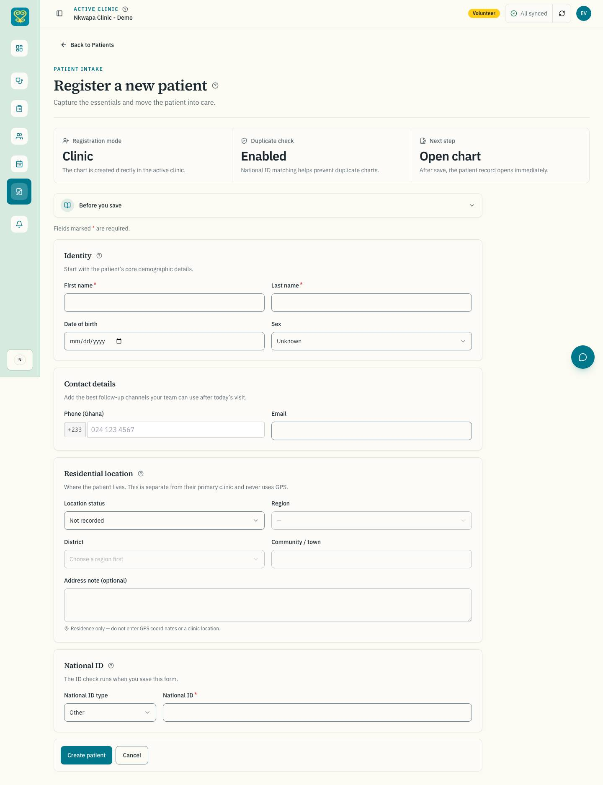
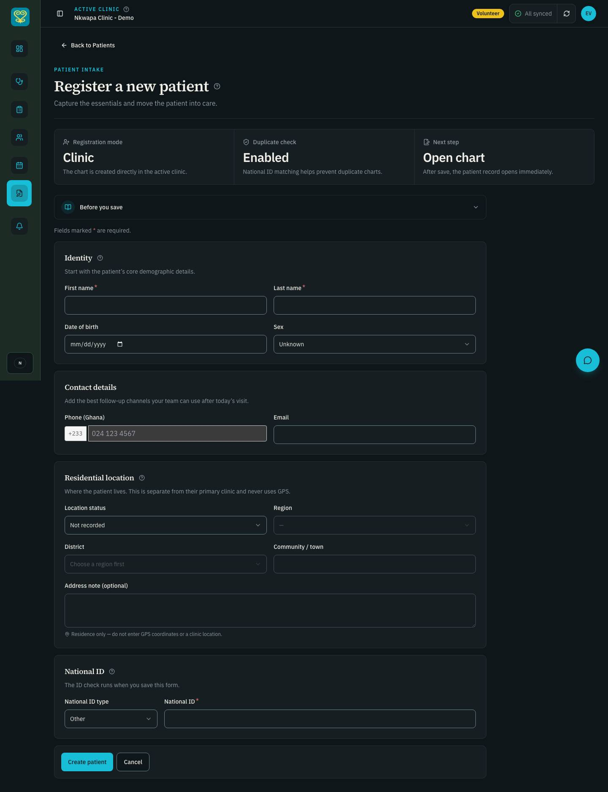
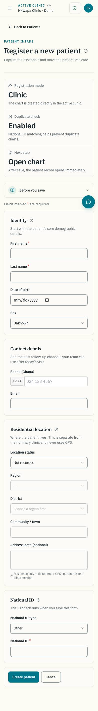
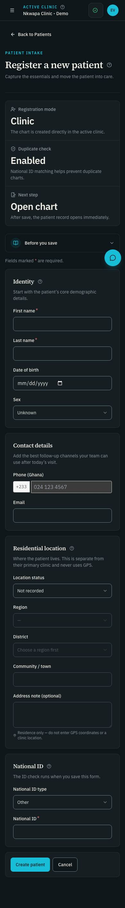

# Registration accessibility fix (#261)

Before Phase 01, captured 2026-11-01 (America/Chicago). Parent: #229.

## Scope and diagnosis

Confirmed on `release/dev` at `79d3f42`: `/patients/new` has one critical
`button-name` violation in each light/dark, desktop/mobile scan. Axe's failing
node is the Sex `SelectTrigger`, which has no associated label. The fix connects
the existing visible label using `htmlFor="sex"` and `id="sex"` in the shared
`RegisterPatientScreen` used by both registration routes.

## Reproduction

Build with the E2E job's CI feature flags, rate limits and email configuration
from `.github/workflows/ci.yml`, as required by `CODEX-HANDOFF.md`. Use local
seed fixtures and the running Postgres, Redis, Keycloak and Mailpit containers.

```bash
npm run build --workspace=@nkwapa/web
cd apps/web
DESIGN_BASELINE=1 DESIGN_BASELINE_DIR=/tmp/nkwapa-261-before npx playwright test e2e/design-baseline.spec.js --workers=1 --grep 'volunteer /patients/new'
```

Repeat against the fixed branch with `DESIGN_BASELINE_DIR=/tmp/nkwapa-261-after`.
The opt-in baseline captures 1440, 768 and 390px screenshots and runs axe at
1440 and 390px in both themes. Only the affected route is captured for this fix.
The committed screenshots below are the eight relevant before/after images,
using seeded volunteer identity and a blank registration form.

The new regression test was run against the unchanged production build first:
it failed because `getByRole('combobox', { name: 'Sex', exact: true })` found no
control. After rebuilding, run it with the baseline and existing no-ID workflow
in one Playwright invocation, with one worker.

```bash
DESIGN_BASELINE=1 DESIGN_BASELINE_DIR=/tmp/nkwapa-261-after npx playwright test e2e/design-baseline.spec.js e2e/patient-registration-accessibility.spec.js e2e/patient-no-id.spec.js --workers=1 --grep 'volunteer /patients/new|registration controls|registers a patient with no ID'
```

## Evidence

| Viewport and theme | Before                                            | After                                           |
| ------------------ | ------------------------------------------------- | ----------------------------------------------- |
| 1440px light       |  |  |
| 1440px dark        |    |    |
| 390px light        |    |    |
| 390px dark         |      |      |

The decoded pixels of every before/after pair are identical. Impeccable's
mechanical scan reported no deterministic findings in the changed component.
The visual review preserved the approved typography, spacing, theme and clinical
control treatment. No new visual direction is introduced; the Taste guidance's
preserve-existing-design rule applies to this accessibility repair.

| WCAG-tagged axe result | Before                   | After        |
| ---------------------- | ------------------------ | ------------ |
| 1440px light           | 1 critical `button-name` | 0 violations |
| 390px light            | 1 critical `button-name` | 0 violations |
| 1440px dark            | 1 critical `button-name` | 0 violations |
| 390px dark             | 1 critical `button-name` | 0 violations |

See [before axe JSON](axe-before.json) and [after axe JSON](axe-after.json).
Horizontal overflow was absent in all four before and after scans.

## Limitations and rollback

This is a focused registration check, not product-wide accessibility sign-off.
An additional unrestricted axe diagnostic reported the existing moderate
`heading-order` best-practice finding at the Identity heading; it is outside the
baseline's WCAG tag set and this label fix. Manual VoiceOver was not performed;
the product-wide manual pass remains in #282. The full clinical E2E suite was
not run for this two-attribute repair.

Revert the PR to roll back. There are no dependency, database, permission,
validation, default or save-semantics changes.

## Automated verification

- `npm run security:scan`, repository lint and typecheck: passed.
- Web Jest with `--maxWorkers=2`: 79 suites, 919 tests passed.
- CI-configured production builds before and after: passed.
- Repository-wide `npx prettier --check .`: passed.
- Before baseline: 8 passed (7 authentication setup tests and the affected route).
- After baseline and existing no-ID registration/update/duplicate workflow: passed.
- New keyboard/axe regression: 4 passed in the final focused run. Early test
  runs exposed date-input segment Tab stops and a typeahead focus race in the
  test itself. The final test tabs backward from Phone, waits for the selected
  option's focus on opening, and waits for typeahead focus before Enter.
- The before-build regression failed as expected on the missing accessible name.
