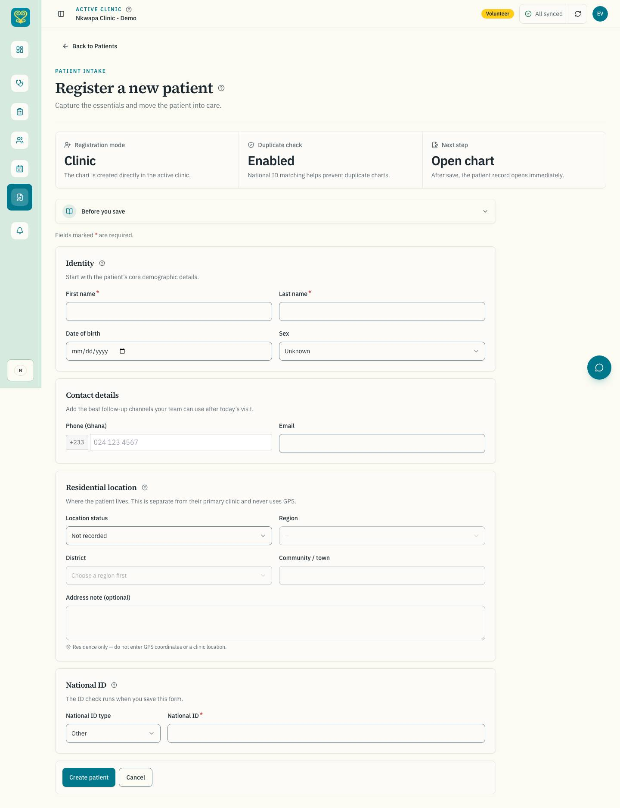
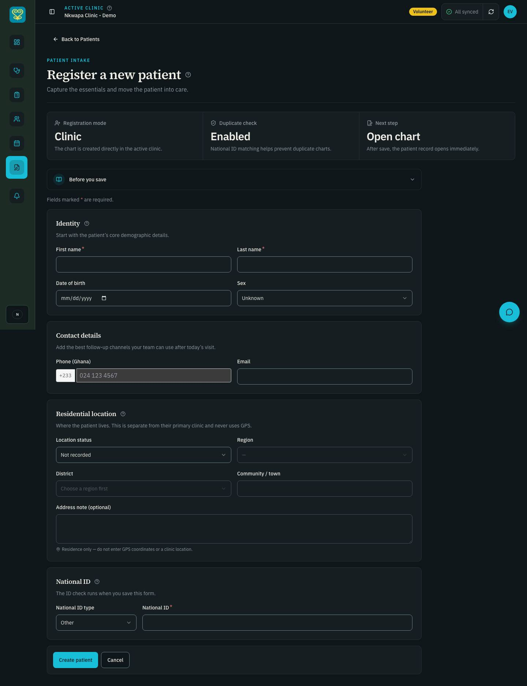
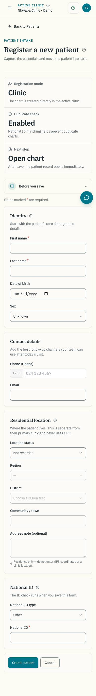
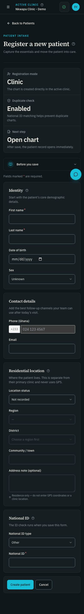
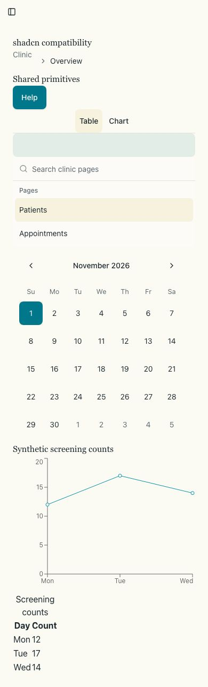
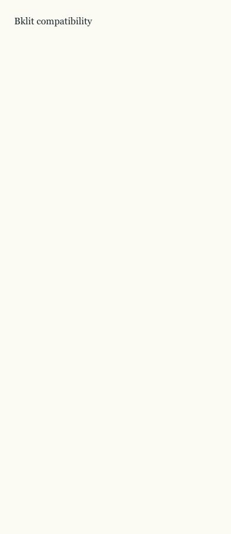
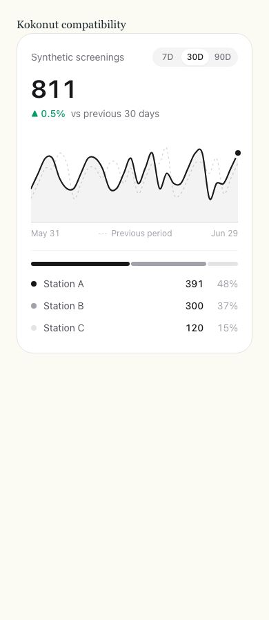
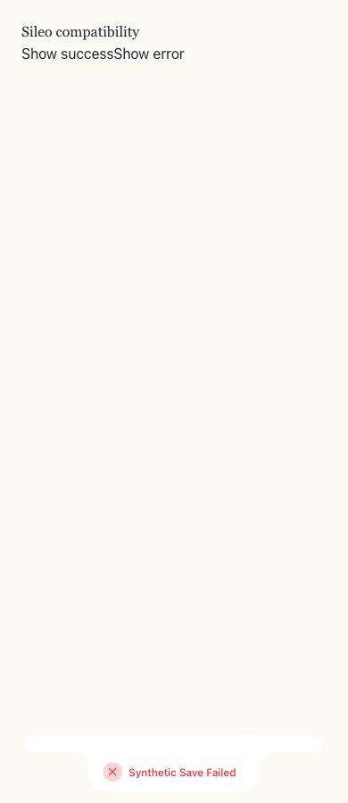

# #263: UI feasibility and self-hosted fonts

Captured 2026-11-01 (America/Chicago) for epic #229. Base: `release/dev` at
`ed2cbd5`, the merge of the #261 accessibility fix in PR #286.

## Production change and scope

`app/layout.tsx` now uses `IBM_Plex_Sans` and `Source_Serif_4` from
`next/font/google`, variable weights, `display: 'swap'`, and the existing
`--font-body` / `--font-heading` variables on `<html>`. The old Google Fonts
`@import` and literal font-variable declarations are removed from `globals.css`.
Next downloads the fonts while building and serves hashed first-party WOFF2
assets. It preloads Latin, while retaining the other subsets for names. There
are no runtime font-host requests. Builds still require Google Fonts access.

The measured build includes 12 font subset files, 318,328 bytes in total. The
two Latin preload files total 91,192 bytes. These are asset bytes, not JavaScript
bundle bytes or a measured latency improvement. No production package file,
lockfile, registry, UI component or framework version changes in this PR.

The baseline plan now includes the Manager-only and Director-only identities
merged in #285, as required by the handoff for the first PR that needs them.

## App verification

The unchanged production build was captured before the font edit. The after
build used the same local seeded services and E2E CI environment. Each invocation
used one Playwright worker; no reseed or production service was used.

| Check                                                    | Result                                                                                                                  |
| -------------------------------------------------------- | ----------------------------------------------------------------------------------------------------------------------- |
| Before baseline                                          | 34 tests passed: 7 auth setups plus 27 routes; 162 screenshots, 108 WCAG axe scans                                      |
| After baseline                                           | Same 27 routes, widths 1440/768/390, both themes; 162 screenshots, 108 WCAG axe scans                                   |
| Axe / overflow                                           | 0 violations and 0 horizontal-overflow findings in all 108 scans, before and after                                      |
| Focused screenshot pairs below                           | All four decoded before/after images are pixel-identical                                                                |
| Combined after E2E invocation                            | 57 passed, including baseline, font loading, registration keyboard/axe, role access, workspace smoke and Keycloak theme |
| Web Jest, capped at 2 workers                            | 79 suites / 919 tests passed                                                                                            |
| Production web build                                     | Passed with CI feature flags                                                                                            |
| Security scan, repository lint, typecheck, chart palette | Passed                                                                                                                  |
| Impeccable scan of changed UI source                     | No deterministic findings                                                                                               |

`font-loading.spec.js` blocks `fonts.googleapis.com`, `fonts.gstatic.com` and
`fonts.cdnfonts.com`, verifies that both applied families are loaded, and checks
that their font requests and preload links use the app's first-party
`/_next/static/media/*.woff2` paths. It runs in both themes.

The visual review preserves the incumbent typography and geometry. This is
font delivery and feasibility work, not the #264 type-scale or token redesign.
The Taste guidance to preserve the existing design applies; no alternative
visual direction is introduced.

### Screenshots

Seeded volunteer identity, blank registration form. Full baseline screenshots
remain outside git; these are the four pairs required for PR review.

| View         | Before                                            | After                                           |
| ------------ | ------------------------------------------------- | ----------------------------------------------- |
| 1440px light |  |  |
| 1440px dark  |    |    |
| 390px light  |    |    |
| 390px dark   |      |      |

[Before axe JSON](axe-before.json) · [After axe JSON](axe-after.json).

### Reproduction

First load the E2E job's `FEATURE_*`, `NEXT_PUBLIC_*`, rate-limit and mail
configuration from `.github/workflows/ci.yml`, as described in the handoff.
Do not print `.env`, use production patient data or reseed unnecessarily.

```bash
# Before: unchanged release/dev production build, same baseline plan.
cd apps/web
DESIGN_BASELINE=1 DESIGN_BASELINE_DIR=/tmp/nkwapa-263-before npx playwright test e2e/design-baseline.spec.js --workers=1

# After: rebuild with the same CI environment, then one test invocation.
cd ../..
npm run build --workspace=@nkwapa/web
cd apps/web
DESIGN_BASELINE=1 DESIGN_BASELINE_DIR=/tmp/nkwapa-263-after npx playwright test e2e/design-baseline.spec.js e2e/font-loading.spec.js e2e/patient-registration-accessibility.spec.js e2e/role-access.spec.js e2e/workspace-smoke.spec.js e2e/login-theme.spec.js --workers=1
```

## Disposable compatibility experiment

The spike used a separate worktree/branch, `spike/263-ui-feasibility`, from the
same `release/dev` commit. A minimal Next app at that worktree's root copied
the actual web `components.json`, Tailwind config, CSS, utilities and existing
primitives. Its package manifest pinned Next 16.3.0-canary.104, React/React DOM
18.3.1 and Tailwind 3.4.19. This isolates UI compatibility from unrelated API /
database workspace installation. Resolve React from `apps/web`, not from the
repo root, which hoists a different version.

The registry is mutable. [spike-results.json](spike-results.json) records the
CLI version, resolved package versions, hashes of the CLI registry snapshots,
generated source hashes, source sizes, bundle sizes and font asset measurements.
No experimental dependency or copied registry source enters production.

```bash
# In a throwaway worktree harness with the exact web stack and copied configs:
npx --yes npm@10 install --ignore-scripts --no-audit --no-fund
npx --yes --package=npm@10 --package=shadcn@4.23.0 shadcn add sidebar chart breadcrumb command skeleton tooltip toggle-group calendar separator --yes
# Answer no to overwriting the incumbent Button, Sheet, Input, Card and Dialog.

# Configure these registries in the throwaway components.json only:
# @bklit: https://ui.bklit.com/r/{name}.json
# @kokonutui: https://kokonutui.com/r/{name}.json
npx --yes --package=npm@10 --package=shadcn@4.23.0 shadcn add @bklit/line-chart @kokonutui/metric-card --yes
# Preserve the incumbent utils.ts.
npx --yes npm@10 install --save-exact recharts@3.10.1 sileo@0.1.6 --ignore-scripts --no-audit --no-fund
```

### Confirmed compatibility findings

- **Package manager:** the copied `pnpm-workspace.yaml` made the CLI choose pnpm
  and fail its workspace-root check. The disposable harness removed that copied
  marker and explicitly set `packageManager: "npm@10.9.9"`. Production files were
  not changed. Always inspect the package manager before using the CLI here.
- **Recharts:** the legacy shadcn registry requested 2.15.4, downgrading the spike
  until it was restored to the production 3.10.1. The raw generated chart then
  produced ten TypeScript errors. [Original errors](shadcn-recharts3-errors.txt).
  The adaptation uses Recharts 3's `TooltipContentProps` and `LegendPayload`,
  and converts a possible function-valued data key to a string for React keys.
- **Tailwind:** the CLI correctly detects v3 and mostly emits v3 source. The
  generated Calendar nevertheless contains `shadow-xs`, `has-focus:` and
  `rtl:**` fragments associated with v4, plus 32px default cells. It is not an
  unchanged drop-in. Sidebar installation also rewrites sidebar colours/config;
  those generated values must not replace the approved tokens.
- **Bklit:** the LineChart install copied 92 source files and added D3 / Motion
  14.9.0. Its CSS injection overwrote all five clinical chart tokens with OKLCH
  values, breaking existing `hsl(var(--chart-N))` consumers. One nullable
  `RefObject<SVGPathElement | null>` declaration causes two React 18 ref errors.
  It was adapted to the React 18 equivalent for the runtime experiment.
  [Type errors](fixture-original-type-errors.txt) and
  [Recharts and ref adaptations](spike-type-adaptations.patch) (zero-context patch,
  apply with `git apply --unidiff-zero`).
- **Kokonut:** the inspected MetricCard header declares 2.0.0, dated 2026-10-17.
  It uses React 18-compatible hooks, with no added package in this candidate.
  It uses raw zinc colours / `dark:` variants and morphs resampled curves, rather
  than the approved ruled metrics and straight clinical data segments.
- **Sileo:** npm 0.1.6 declares React/React DOM `>=18`, `motion ^12.34.0`, and no
  Tailwind peer. Its public types offer `show`, per-tone methods, `promise`,
  `dismiss` and `clear`, but no `id`-based update. The rendered error toast is
  `aria-live="polite"`. Those are blockers against the current `showToast`
  contract. This does not replace #280's full evaluation.

The fixture typecheck and Next production build pass after the recorded type
adaptations. No validation was disabled, no React upgrade was used, and no
error was hidden to make the spike pass.

### Accessibility and responsive experiment

The production-built fixtures rendered all nine shadcn candidates, a Bklit line
chart, Kokonut MetricCard with explicit synthetic data and a Sileo error toast.
Each ran WCAG-tagged axe at 1440 and 390px in light and dark, reduced motion.
All 16 final scans have no runtime page errors or horizontal overflow.

| Fixture                  | Final WCAG axe result                                                                            | Interpretation                                                                                                                |
| ------------------------ | ------------------------------------------------------------------------------------------------ | ----------------------------------------------------------------------------------------------------------------------------- |
| shadcn, adapted          | 0 violations in all 4 scans; 0 measured targets below 44px                                       | Feasible with explicit integration work, not unchanged wholesale adoption                                                     |
| Bklit, ref types adapted | 0 violations in all 4 scans                                                                      | Axe does not detect the palette contract, natural-curve default, chart-animation policy or duplicate-stack cost; still reject |
| Kokonut MetricCard       | `color-contrast`, serious: 8 nodes per light scan, 6 per dark scan; 6 sampled targets below 44px | Reject the candidate; defaults also conflict with the visual/data contracts                                                   |
| Sileo error toast        | 0 violations in all 4 scans; error region is `polite`                                            | Axe does not test the wrapper's assertive-error or id-update contract; reject adoption, keep Sonner                           |

The two small targets recorded on the Sileo page are the harness's Show buttons,
not a claim about Sileo's optional action button. The final shadcn harness maps
sidebar and chart tokens to the app's measured HSL values, applies 44px targets /
calendar cells and a visible SVG focus rule. It renders straight, non-animated
Recharts data and a table alternative. These integration styles are fixture-only;
future production adoption needs deliberate component variants, not a broad CSS
selector copied from the experiment.

The first diagnostic fixture pass exposed two mistakes in the harness itself:
missing page titles and an ARIA label on a generic Skeleton div. Both were fixed
with real document metadata and a named status wrapper before the final scans.
They are not attributed to the libraries. A first toast probe also assumed two
simultaneously ready toasts; the final probe inspects one error toast directly.

[Full final fixture axe JSON](fixture-axe.json).

| Adapted shadcn                                      | Bklit                                             | Kokonut                                               | Sileo                                             |
| --------------------------------------------------- | ------------------------------------------------- | ----------------------------------------------------- | ------------------------------------------------- |
|  |  |  |  |

### Bundle experiment

Measured with esbuild 0.28.2: production, minified browser ESM, React and React
DOM external, other dependencies included, all exports from each candidate
module. These are **standalone comparison sizes**, not incremental app-route
costs. Shared dependencies mean the figures must not be added together.

| Candidate           | Minified bytes | Gzip bytes |
| ------------------- | -------------: | ---------: |
| shadcn sidebar      |        148,232 |     48,573 |
| shadcn chart        |        283,612 |     88,095 |
| shadcn breadcrumb   |         34,120 |     11,225 |
| shadcn command      |         85,280 |     27,981 |
| shadcn skeleton     |         27,541 |      8,722 |
| shadcn tooltip      |         83,919 |     28,599 |
| shadcn toggle-group |         61,500 |     18,925 |
| shadcn calendar     |        108,500 |     33,478 |
| shadcn separator    |         32,064 |     10,562 |
| Bklit line-chart    |        235,619 |     82,205 |
| Kokonut metric-card |         42,140 |     13,926 |
| Sileo               |        147,191 |     48,810 |

Even dependency-free Skeleton includes shared `cn` utilities in this standalone
measurement; its generated source alone is 266 bytes / 213 bytes gzip. Do not
interpret its 8,722-byte standalone bundle as an added application cost.

## Decision and limitations

Proposed decisions in MASTER.md section 13: adopt shadcn selectively, reject
Bklit/Kokonut for this redesign, reject Sileo adoption and retain Sonner.
**Owner approval is required before merge** by `CODEX-HANDOFF.md` section 8.
No new production dependency is introduced while that decision is pending.
Stop after this PR; #264 has not started.

Axe covers automated WCAG rules, not every clinical, data, keyboard or screen
reader requirement. Full VoiceOver and product-wide clinical regression remain
in their later phases. Fixture results are not evidence that a library can be
installed unchanged, and mutable registry hashes are snapshots, not upstream
semver releases. Build-time font retrieval is a remaining external dependency.

Rollback: revert the PR to restore the previous font import and documentation.
No database, permission, clinical or dependency rollback is needed.
