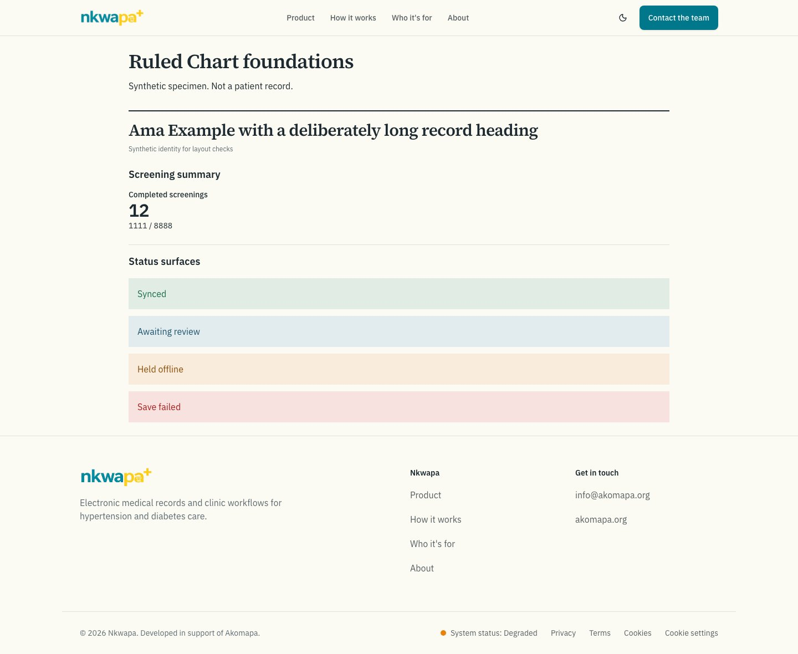
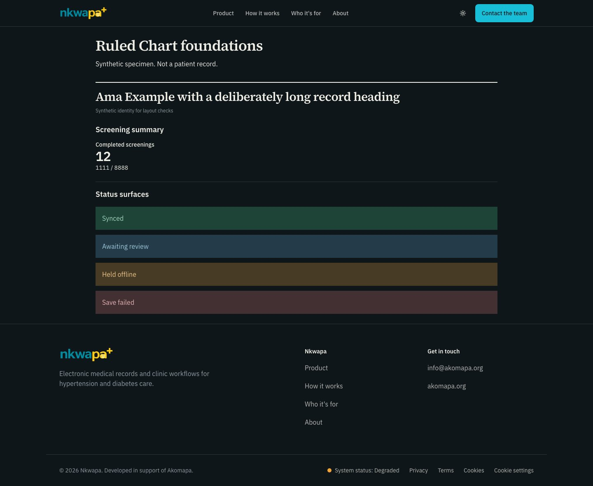
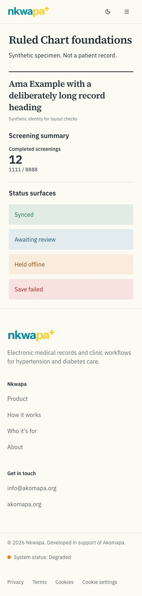
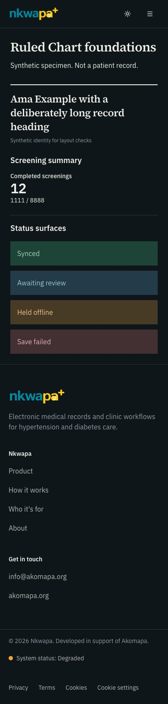
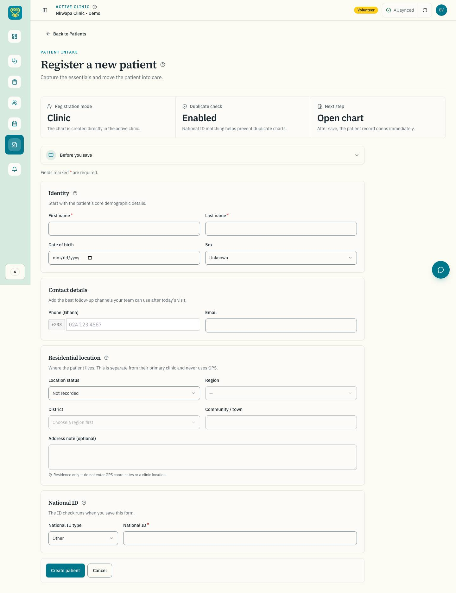
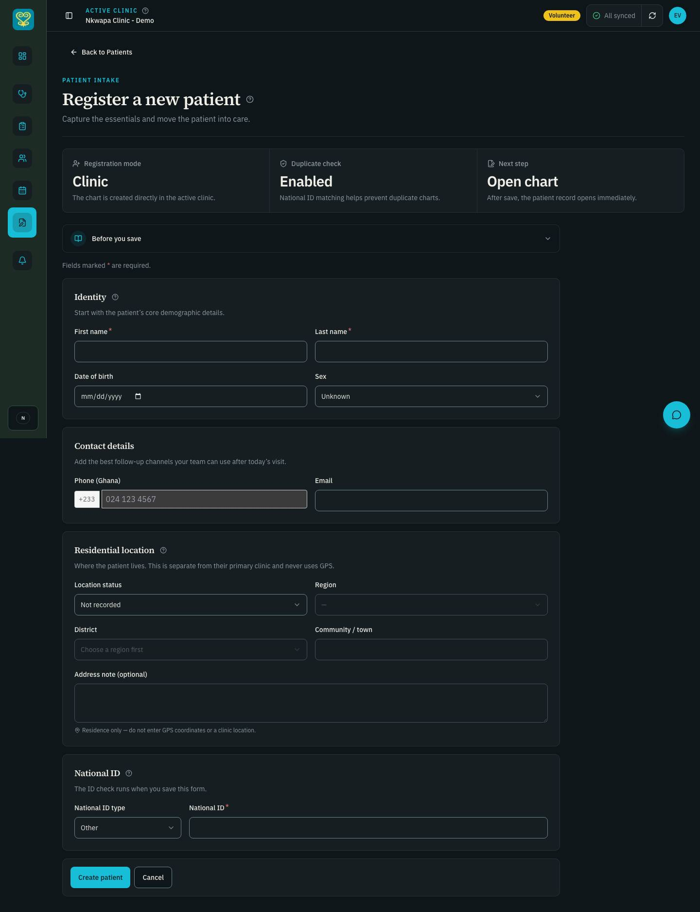
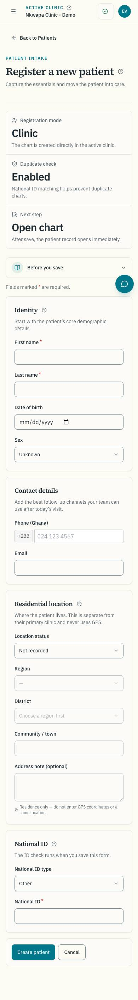
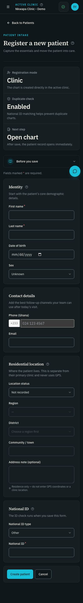

# #264: semantic tokens and typography

Captured 2026-11-01 (America/Chicago), epic #229. Branch started directly from
`release/dev` at `c3e654b`, the merge of #263 / PR #287 with all CI checks passing.

## What changes

The foundation adds `--rule` / `--rule-strong` and four opaque status surfaces,
with explicit values in both themes. Existing HSL action, ink, input and chart
colours are unchanged. Decorative hairlines remain exempt from non-text
contrast; they must not identify a form control. Strong rules pass 3:1, and all
four status text/surface pairs pass 4.5:1 in both modes.

Eight opt-in type roles use the existing self-hosted Source Serif 4 and IBM Plex
Sans families. Titles and patient names use the serif; operational section
headings, body, labels, metadata and figures use Plex. Metrics/data use tabular
figures. Sizes/line heights live in rem in the Tailwind config, and long titles
can wrap rather than overflow. MASTER.md section 6 records the role scale.

This issue stages the foundation without migrating existing components or
restyling all pages. #265 owns those shared consumers. The small set of public
type roles and new colour utilities is safelisted so the production CSS can be
rendered before that migration. No new product demo route, package dependency,
clinical field/default, API, permission, validation or save behaviour is added.
Chart animation and selective UI-library adoption decisions remain unchanged.

## Contrast evidence

[All 24 full-precision pair measurements](token-contrast.json).

| Status surface and existing ink |  Light |   Dark |
| ------------------------------- | -----: | -----: |
| Success                         | 5.20:1 | 6.83:1 |
| Warning                         | 5.90:1 | 6.75:1 |
| Info                            | 7.29:1 | 6.37:1 |
| Destructive                     | 6.02:1 | 6.66:1 |

Strong rule contrast: 14.30/15.66:1 on canvas and 14.31/14.50:1 on card
(light/dark). Decorative rule contrast: 1.26/1.47:1 on canvas and 1.26/1.36:1
on card, correctly exempt. The report also records primary/supporting neutral
text pairings. Ratios are compared at full precision, then rounded for display.
Opaque surfaces were derived from 12% fill over the light card and 22% over the
dark card, rounded to 0.1 HSL units and measured again.

`npm run design:check-tokens` checks the intended pairs, resolves aliases and
requires the new roles in both theme blocks. CI now runs it beside the chart
palette check. Tests verify WCAG endpoints, deliberately regress dark text
contrast, remove a dark surface, and exercise missing/circular aliases.

[Chart palette check](chart-palette.txt) confirms the existing series values and
CVD separation. Its existing chart-2 and all-pairs warnings remain documented in
MASTER.md; no chart colour has been changed to conceal them.

## Rendered specimen

`design-foundations.spec.js` loads `/privacy`, replaces only its main content
with a static synthetic specimen, and exercises the actual production CSS. This
is test-only content, not a new public route or a production clinical screen.
It checks the two font families, role sizes/line heights/weights, responsive title
sizes, equal-width digits, opaque computed status backgrounds, browser-computed
contrast, zero WCAG axe findings and normal-width overflow. It then sets root
text size to 200% and checks that body text doubles and the specimen still fits.
This is a specimen text-scaling check, not a claim of full-product zoom sign-off.

The one figure is a synthetic count, and the example name is explicitly
synthetic. Status meaning is written in words, never carried by colour alone.

| 1440px light                                          | 1440px dark                                         |
| ----------------------------------------------------- | --------------------------------------------------- |
|  |  |

| 390px light                                         | 390px dark                                        |
| --------------------------------------------------- | ------------------------------------------------- |
|  |  |

Visual review confirms serif title/name roles, Plex operational text, clear
figure hierarchy, quiet rules and readable status surfaces in both themes.
The Impeccable type scan reported no deterministic findings before or after.
The Taste guidance to preserve the approved visual direction applies; this is
foundation work rather than a new concept or page redesign.

## App before/after baseline

Each baseline covers 27 routes across public, staff, doctor, volunteer, manager,
director and patient roles. It captures 162 screenshots at 1440/768/390 in light
and dark and runs 108 WCAG axe scans at 1440/390.

Both baselines have **zero violations and zero horizontal-overflow findings**.
The four selected blank-registration image pairs below are pixel-identical,
consistent with staging the foundation ahead of #265's component migration.
Only a seeded volunteer identity and blank form are shown.

[Before axe JSON](axe-before.json) · [After axe JSON](axe-after.json).

| View         | Before                                            | After                                           |
| ------------ | ------------------------------------------------- | ----------------------------------------------- |
| 1440px light |  |  |
| 1440px dark  |    |    |
| 390px light  |    |    |
| 390px dark   |      |      |

## Executed checks

- Before baseline: 34 passed (7 auth setups, 27 routes).
- Combined after E2E: **44 passed**, including the baseline, 4 foundation
  specimen cases, 2 font-loading cases and 4 registration keyboard/axe cases.
- Web unit tests, `--maxWorkers=2`: **79 suites / 919 tests passed**.
- Repo script tests: **20 passed**, including the 4 new contrast-check tests.
- CI-configured final production build, repository lint and typecheck: passed.
- Security scan, semantic token check, chart palette check: passed.
- Formatting and diff whitespace checks are run again before commit/push.

No test was weakened, no rule was disabled, and no dependency was installed.
Full clinical E2E and manual VoiceOver were not run for this additive CSS
foundation; the full QA phase remains #282. #265 has not started.

## Reproduction

Load the E2E job's feature flags, public feature flags, rate limits and email
configuration from `.github/workflows/ci.yml`, following CODEX-HANDOFF.md. Use
local seeded Postgres, Redis, Keycloak and Mailpit, not production data. No reseed
was needed for this read-only baseline/specimen run.

```bash
npm run design:check-tokens
node scripts/check-design-tokens.mjs --json
npm run design:check-charts
npm run test:scripts
npm run test --workspace=@nkwapa/web -- --maxWorkers=2

# Before: unchanged release/dev production build, with the same CI environment.
cd apps/web
DESIGN_BASELINE=1 DESIGN_BASELINE_DIR=/tmp/nkwapa-264-before npx playwright test e2e/design-baseline.spec.js --workers=1

# After: final production build with CI flags, one Playwright invocation.
cd ../..
npm run build --workspace=@nkwapa/web
cd apps/web
DESIGN_BASELINE=1 DESIGN_BASELINE_DIR=/tmp/nkwapa-264-after DESIGN_FOUNDATIONS_DIR=/tmp/nkwapa-264-specimen npx playwright test e2e/design-baseline.spec.js e2e/design-foundations.spec.js e2e/font-loading.spec.js e2e/patient-registration-accessibility.spec.js --workers=1
```

Rollback: revert the PR. No dependency, database or clinical rollback is needed.
